

# Nitish Kumar Kushwaha

**Full-Stack Engineer · Production Software & Applied AI**

I take products from idea to production — learning platforms, payments, automation, and AI-backed tools — with clean UX and reliable backends.

---

## Explainer

A 1 min 40 sec walkthrough of my work — learning platforms, payments, and full-stack products.

<!-- To play the video inline on GitHub: edit this file on github.com, drag the mp4 into the editor,
     and replace this whole block with the https://github.com/user-attachments/... link GitHub generates. -->
<a href="https://drive.google.com/file/d/1mzQ_YsShtPqzAhd4a7Zeyl2s5pEsn8BQ/view?usp=sharing">
  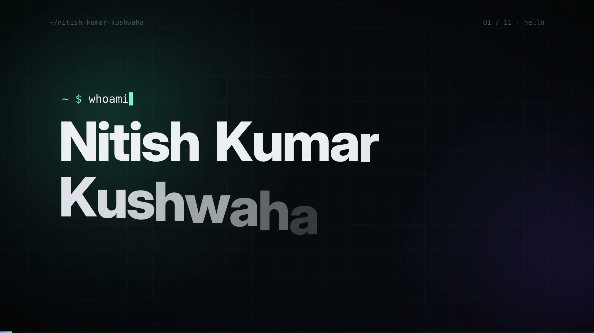
</a>

---

## About Me

- `Software Developer 1` at Bigintsolutions (May 2026 – Present); previously interned at NexisparkX Technologies and Reelife
- B.Tech in Computer Science and Engineering, IIIT Ranchi (`2022 – 2026`, CGPA `7.83`)
- LeetCode: `500+` problems, rating `1799` (Top 10%), `50+` contests, `93-day` POTD streak
- Anthropic API Certified — tool use, RAG, MCP, prompt caching, and agent workflows; I build with AI coding tools every day

> I like building products that reduce friction, simplify messy workflows, and make complex systems feel intuitive.

---

## Experience

### Bigintsolutions — Software Developer 1
`May 2026 – Present` · Remote

- Rebuilt [learn.approachable.dev](https://learn.approachable.dev) from a bare landing page (dashboard, video player, progress tracking) and built [approachable.dev](https://approachable.dev), the company marketing site — first corporate lead within 3 days of launch.
- Built the payment and billing flow from scratch: Razorpay across iOS and Android (every major method except Apple Pay) with IP-based country pricing, Cashfree as a backup gateway, and server-side price resolution so checkout amounts can't be changed from the client. Processed `Rs.2L+` revenue and `34` payments in month 1, with zero errors.
- Automated a Razorpay → Zoho Books invoice workflow so every successful payment raises a customer invoice, and built Zoho Flow and n8n automations for bulk and targeted emails and operational workflows.
- Shipped `3` frontend features for the Haziram production app (`4,000+` workers, `200+` companies) and `1` admin-app feature.
- Owned Datadog monitoring and debugging across services (see [Debugging Notes](#debugging-notes)).
- Built a chat-based video editor that cut internal video-editing time from `6–8 hours` to `2–3 hours`.
- Delivered `600+` commits across `3` projects built from scratch and `1` existing project, in a 6-person team.

### NexisparkX Technologies — MERN Stack Intern
`April 2026 – May 2026` · Remote

- Migrated a production database from Supabase to MongoDB with zero data loss, and built an admin dashboard for NX Solution’s Smart Ecosystem platform.

### Reelife Private Limited — Full Stack Developer Intern
`June 2025 – August 2025` · Remote

- Delivered `10+` production-ready React components and Node.js/Express REST API routes for an internal e-commerce platform, and debugged failures in Postman to improve reliability.

---

## Featured Projects

### AlgoNote AI

<table>
  <tr>
    <td width="54%" valign="top">
      
<strong>Built to solve the fragmented interview-prep workflow by combining DSA practice, note-taking, imports, and personalized revision into one workspace.</strong>

      
Architected a microservices backend across 3 services with an API Gateway on a 6-service Docker Compose stack (AWS EC2), exposing 33 REST endpoints. The product side is an IDE-style workspace with a Monaco editor, one-click LeetCode import, and a YouTube-to-revision-sheet pipeline.

      
<strong>Tech Stack</strong> 
      <code>React</code> <code>Vite</code> <code>Tailwind CSS</code> <code>Monaco Editor</code> <code>Node.js</code> <code>Express</code> <code>PostgreSQL</code> <code>MongoDB</code> <code>Clerk</code> <code>Docker</code>

      
<strong>Links</strong> 
      <a href="https://github.com/nitishkumarkushwaha21/Algonote">Repository</a> • <a href="http://algonote.duckdns.org/">Live Demo</a>

    </td>
    <td width="46%" align="center">
      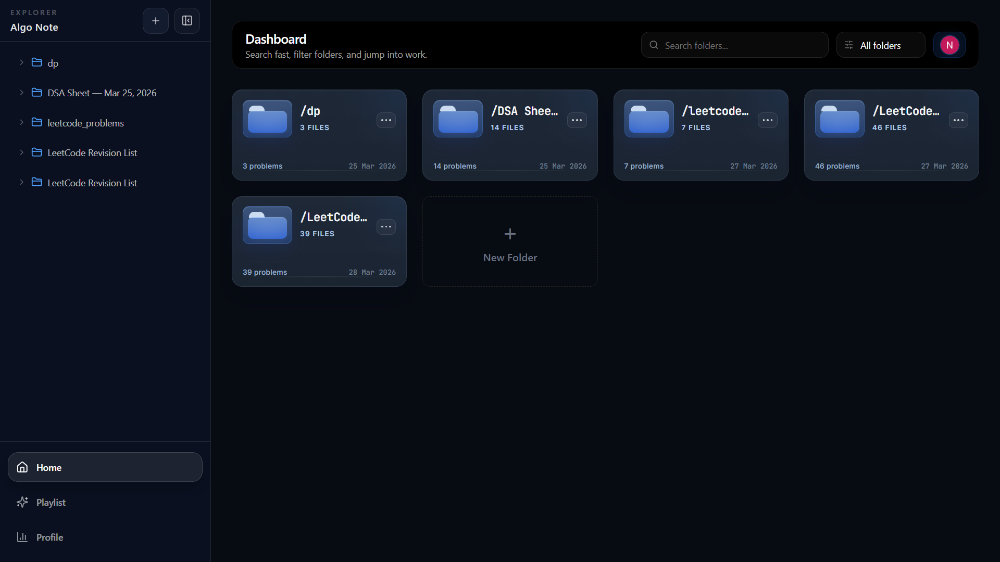
    </td>
  </tr>
</table>

  
<strong>More Screenshots</strong>

   
  

    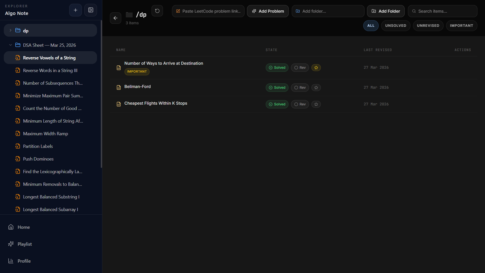
    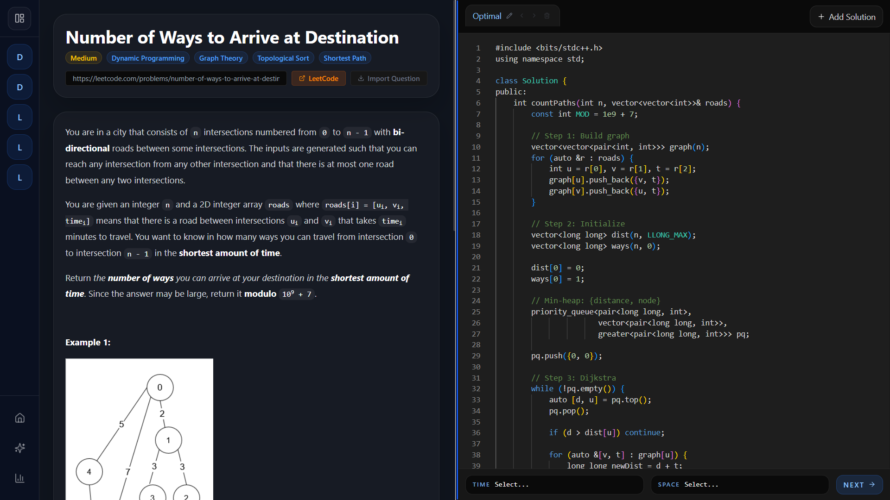
    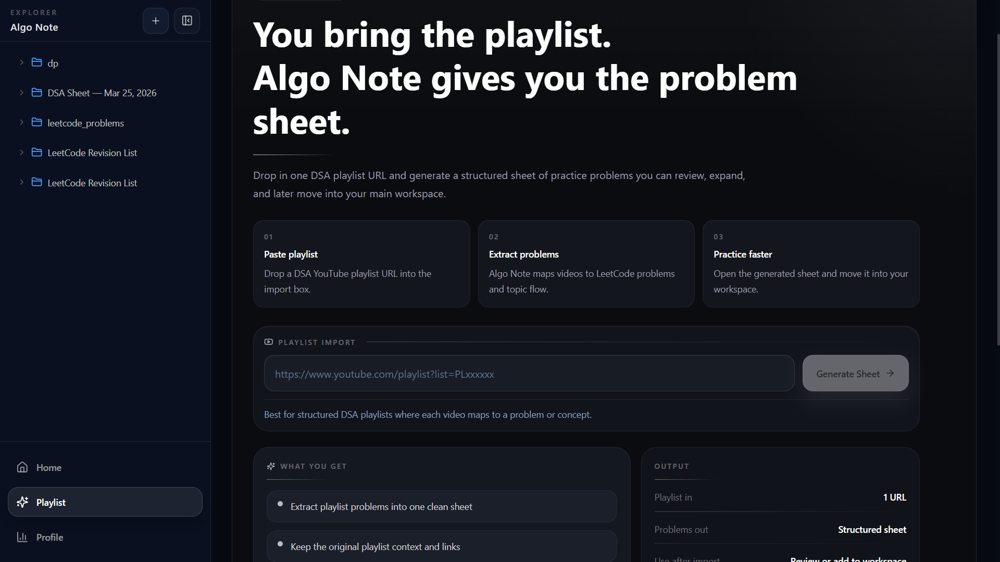
  

  

    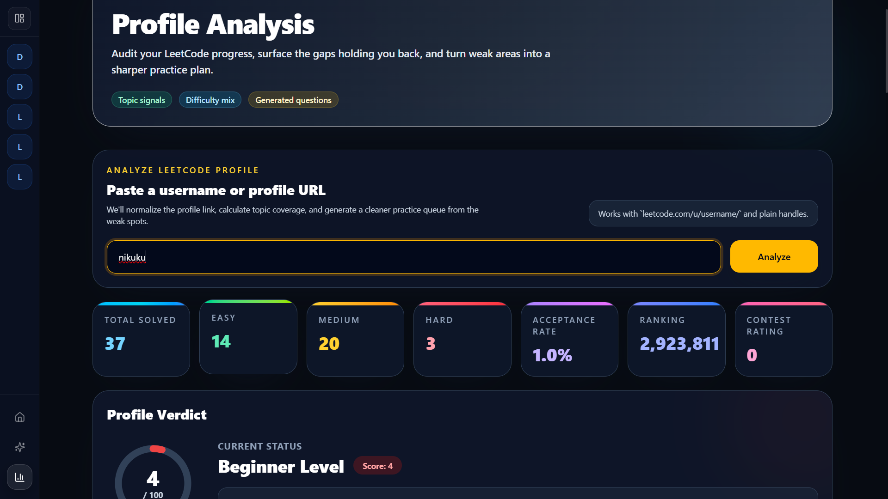
    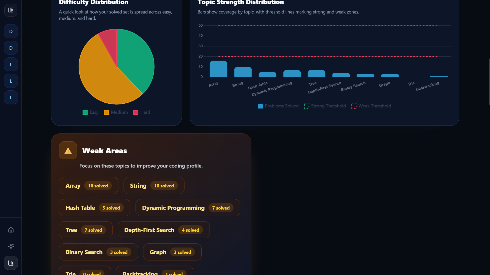
  

---

### n8n Job Hunter

<table>
  <tr>
    <td width="46%" align="center">
      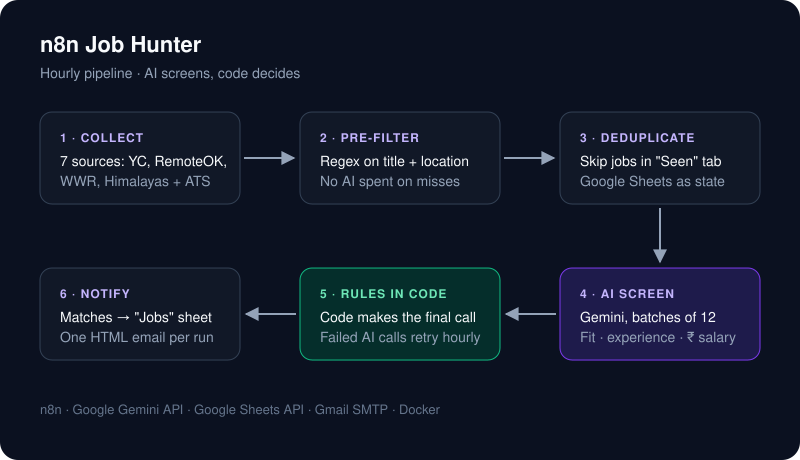
    </td>
    <td width="54%" valign="top">
      
<strong>Built to stop manually checking a dozen job boards every day — an hourly pipeline that finds fresher software roles and emails only the real matches.</strong>

      
A 23-node n8n workflow pulls new listings from YC, RemoteOK, We Work Remotely, Himalayas, and company pages on Greenhouse, Lever, and Ashby. A cheap regex pass and a Google Sheets "seen" list filter out misses and duplicates before any AI call; Gemini then screens the rest in batches for fit, experience, and salary in ₹. The final decision is made by code, not the model, and failed AI calls retry on the next run.

      
<strong>Tech Stack</strong> 
      <code>n8n</code> <code>JavaScript</code> <code>Google Gemini API</code> <code>Google Sheets API</code> <code>Gmail SMTP</code> <code>Docker</code>

      
<strong>Links</strong> 
      <a href="https://github.com/nitishkumarkushwaha21/n8n-job-hunter">Repository</a>

    </td>
  </tr>
</table>

---

### VedaAI Assessment Creator

<table>
  <tr>
    <td width="54%" valign="top">
      
<strong>Built so teachers can configure question types, marks, and difficulty, then generate a structured, syllabus-aligned paper through an LLM pipeline (OpenRouter, GPT-4o-mini).</strong>

      
The strongest engineering part was an async job queue (BullMQ, Redis) with a background worker that streams real-time progress — queued, processing, completed, or failed — to the client over Socket.IO, plus direct PDF export.

      
<strong>Tech Stack</strong> 
      <code>Next.js</code> <code>TypeScript</code> <code>Node.js</code> <code>Express</code> <code>MongoDB</code> <code>Redis</code> <code>BullMQ</code> <code>Socket.IO</code> <code>Clerk</code>

      
<strong>Links</strong> 
      <a href="https://github.com/nitishkumarkushwaha21/vedaai-ai-question-maker">Repository</a> • <a href="https://vedaai-ai-question-maker.vercel.app/">Live Demo</a>

    </td>
    <td width="46%" align="center">
      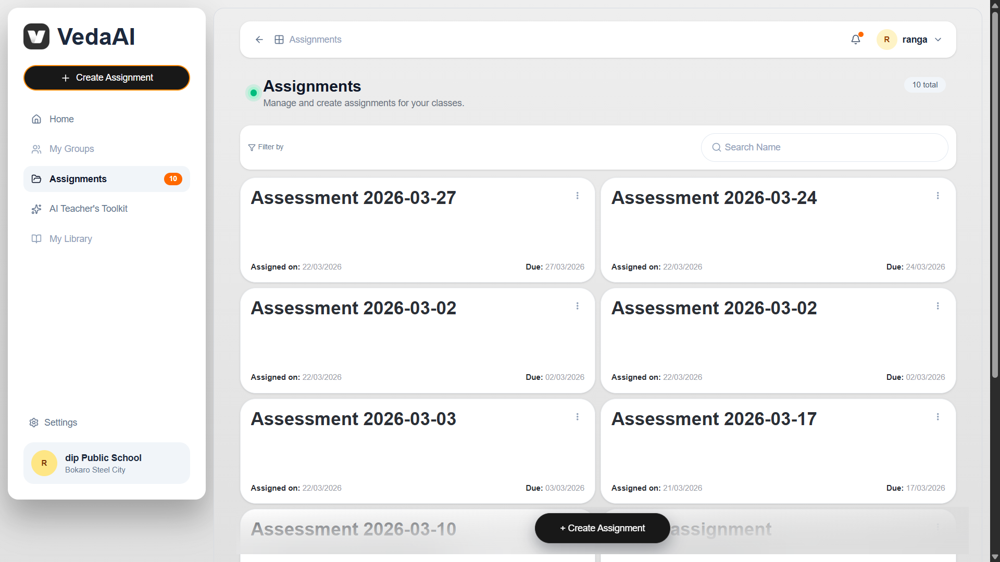
    </td>
  </tr>
</table>

  
<strong>More Screenshots</strong>

   
  

    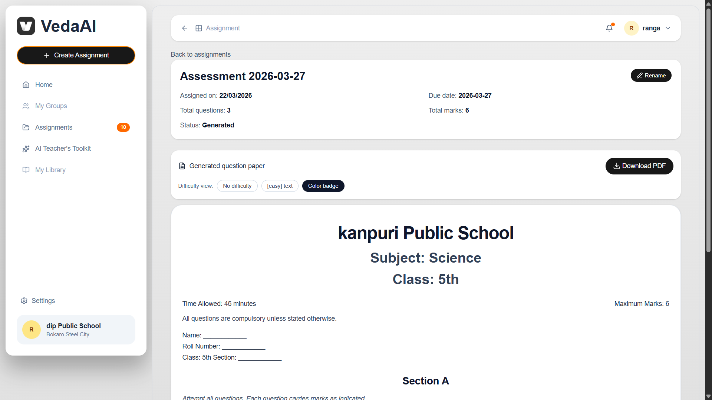
    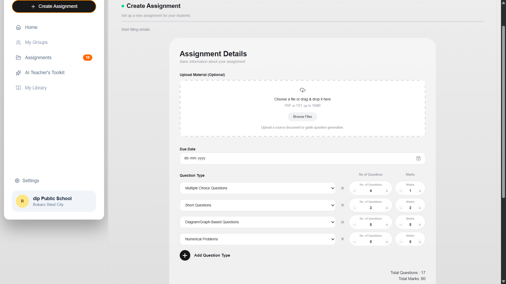
  

---

## More Projects

| Project | What it is | Stack |
| --- | --- | --- |
| **[BuiltByWho](https://freelancer-xi-nine.vercel.app/)** | Studio site for scoping and shipping client websites — case studies (PULSE, Drishya Trails, Root &amp; Rise), services, and a lead form backed by an API for projects, reviews, and inquiries | React, Vite, Node.js, Express, MongoDB |
| **Vantage** *(in progress)* | Real-estate management product | React, Python, PostgreSQL, Docker |
| **Notes extension** | Browser notes with version history — cut repetitive form-filling from about 10 minutes to 1 | JavaScript |
| **Telegram job finder** | Pulls job posts from Telegram channels — cut a 3–4 hour manual search to about 30 minutes | Automation |

  
<strong>BuiltByWho screenshots</strong>

   
  

    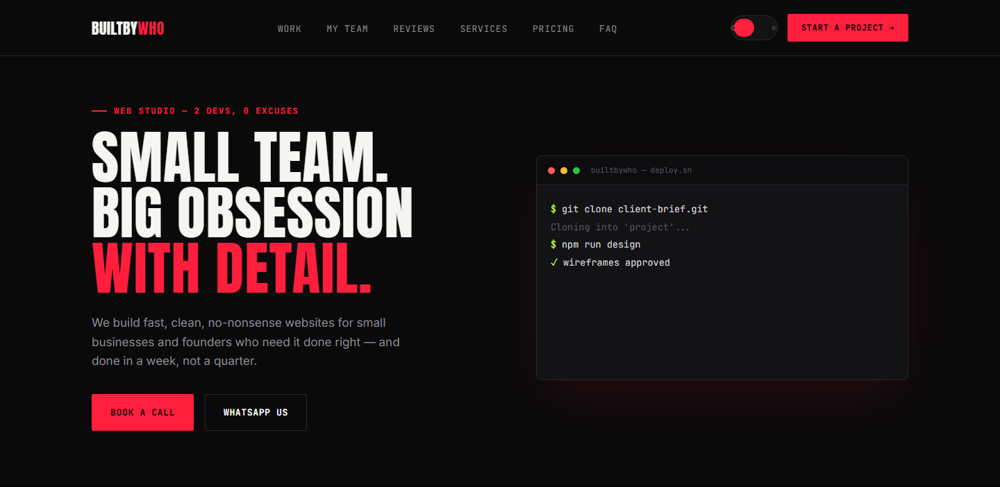
    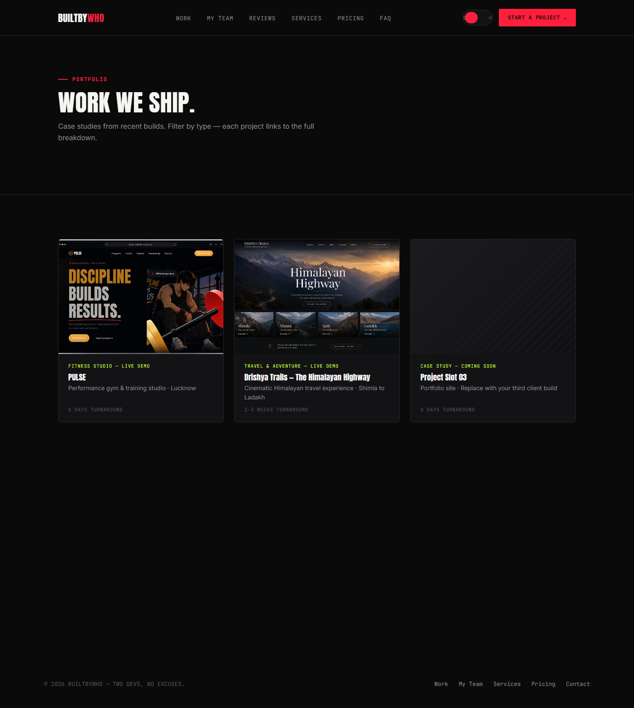
    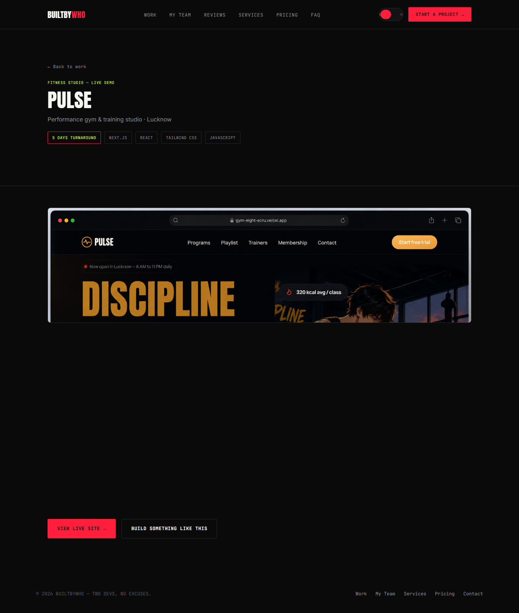
  

  

    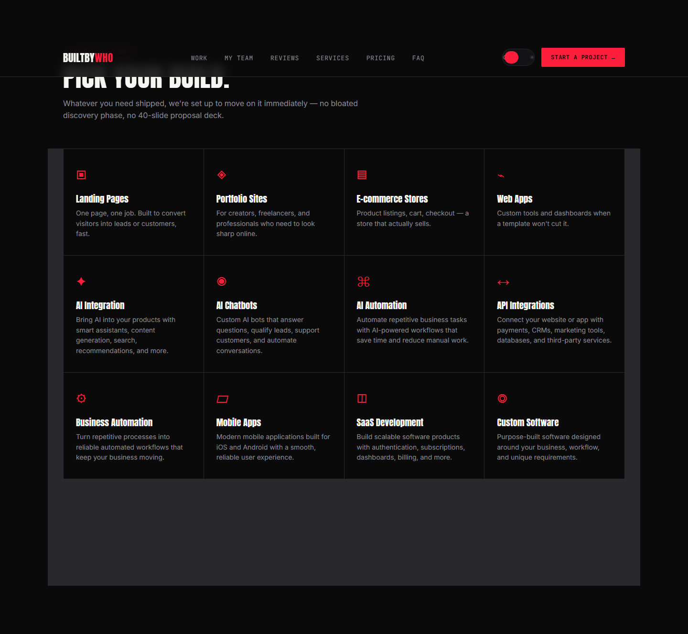
    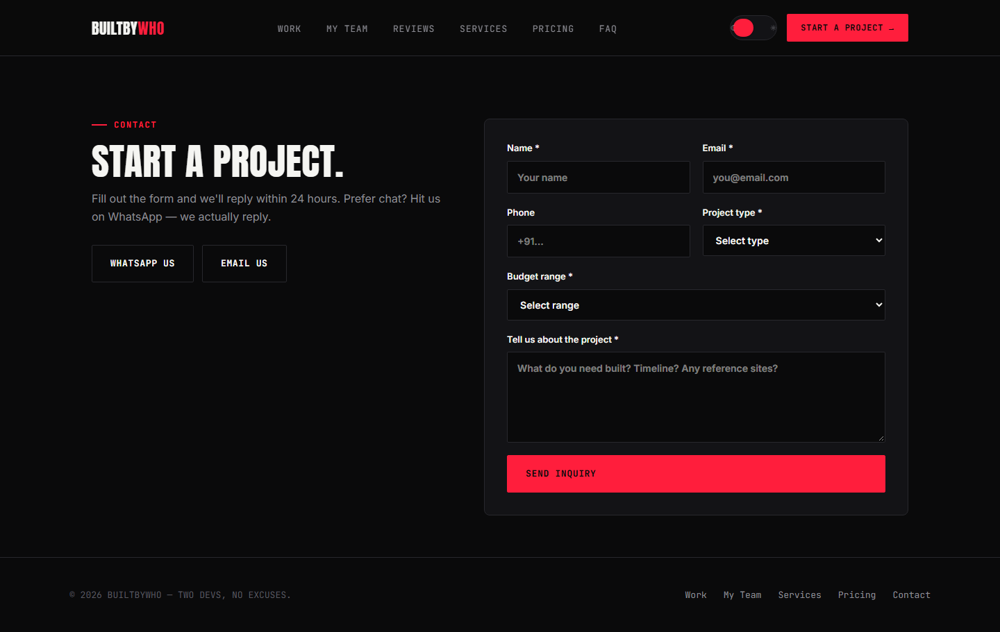
  

---

## Debugging Notes

**A payment gateway that failed with correct code.** A Cashfree integration had to ship in a day, but test payments kept failing even though the application code looked right. I instrumented the API calls, then built a minimal HTML page that called Cashfree directly across API versions. That isolated the failure to the gateway itself; Cashfree confirmed and fixed it the next day, with no changes to our code.

**AI onboarding that finished but produced no profile.** Users completed the onboarding chat, yet their profiles never generated. Correlating Datadog session replays, backend logs, and MongoDB data traced it to concurrent session creation, inconsistent session IDs, and requests exceeding Heroku's 30s timeout — which drove fixes for session consistency, concurrency, recovering saved AI data, and long-running requests.

> My rule from both: reduce the system to a reproducible case and find the failing boundary before changing code.

---

## Skills

### Languages

### Frontend

### Backend

### Databases and Infrastructure

### Payments, Automation, Monitoring, and AI

---

## 🔭 Currently

| Area | What I'm doing |
|------|----------------|
| 🏗️ Building | Production work at Bigintsolutions — learning platform, payments, invoicing, automation, and monitoring |
| 🧪 Side project | Vantage, a real-estate management product (React, Python, PostgreSQL, Docker) |
| 🏀 Beyond code | Captained the IIIT Ranchi basketball team; Vice Head of the Gaming Society (`3+` events, `100+` participants) |

Reach me at <a href="mailto:nitish.kumar.cse2026@gmail.com">nitish.kumar.cse2026@gmail.com</a> or on <a href="https://www.linkedin.com/in/nitishkumar2026">LinkedIn</a>.

