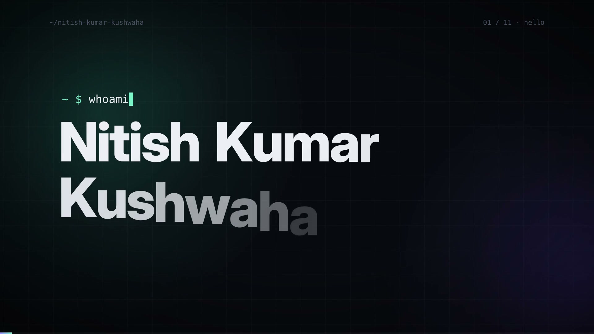

 

**Software Developer • Full-Stack Engineer**

Building production web products — learning platforms, payments, and AI-backed tools — with clean UX and reliable backends.

 

---

## Explainer

A 1 min 40 sec walkthrough of the work — learning platforms, payments, and full-stack products.

 

[Open the video file](./assets/explainer.mp4)

---

## About Me

Software Developer at Bigintsolutions. B.Tech in Computer Science and Engineering, IIIT Ranchi (`2022 – 2026`, CGPA `7.83`). I build full-stack products that feel polished on the frontend and reliable on the backend.

- `Software Developer 1` at Bigintsolutions (May 2026 – Present)
- Previously interned at NexisparkX Technologies and Reelife
- LeetCode: `500+` problems, rating `1799` (Top 10%), `50+` contests, `93-day` POTD streak
- Anthropic API Certified — tool use, RAG, MCP, prompt caching, and agent workflows
- I enjoy vibe coding and exploring what AI can do inside real products

> I like building products that reduce friction, simplify messy workflows, and make complex systems feel intuitive.

## At a Glance

| DSA Problems | Rating | Contests | POTD Streak | LeetCode |
| --- | --- | --- | --- | --- |
| `500+` | `1799` · Top 10% | `50+` | `93 days` | [Profile](https://leetcode.com/u/nitishkumarkushwaha/) |

---

## Experience

### Bigintsolutions — Software Developer 1
`May 2026 – Present` · Remote

- Rebuilt [learn.approachable.dev](https://learn.approachable.dev) from a bare landing page (dashboard, video player, progress tracking) and built [approachable.dev](https://approachable.dev), the company marketing site — first corporate lead within 3 days of launch.
- Integrated Razorpay and Cashfree across iOS and Android (every major Razorpay method except Apple Pay) with IP-based SDK rendering and database-level payment security. Processed `Rs.2L+` revenue and `34` payments in month 1, with zero errors.
- Automated a Razorpay → Zoho Books invoice workflow so every successful payment raises a customer invoice.
- Shipped `3` frontend features for the Haziram production app (`4,000+` workers, `200+` companies) and `1` admin-app feature.
- Owned Datadog monitoring and debugging across services, including duplicate profile creation and a Heroku 30s response timeout.
- Built a chat-based video editor that cut internal video-editing time from `6–8 hours` to `2–3 hours`.
- Delivered `600+` commits across `3` projects built from scratch and `1` existing project, in a 6-person team.

### NexisparkX Technologies — MERN Stack Intern
`April 2026 – May 2026` · Remote

- Migrated a production database from Supabase to MongoDB with zero data loss, and built an admin dashboard for NX Solution’s Smart Ecosystem platform.

### Reelife Private Limited — Full Stack Developer Intern
`June 2025 – August 2025` · Remote

- Delivered `10+` production-ready React components and Node.js/Express REST API routes for an internal e-commerce platform, and debugged failures in Postman to improve reliability.

---

## Featured Projects

### AlgoNote AI

<table>
  <tr>
    <td width="54%" valign="top">
      
<strong>Built to solve the fragmented interview-prep workflow by combining DSA practice, note-taking, imports, and personalized revision into one workspace.</strong>

      
Architected a microservices backend across 3 services with an API Gateway on a 6-service Docker Compose stack (AWS EC2), exposing 33 REST endpoints. The product side is an IDE-style workspace with a Monaco editor, one-click LeetCode import, and a YouTube-to-revision-sheet pipeline.

      
<strong>Tech Stack</strong> 
      <code>React</code> <code>Vite</code> <code>Tailwind CSS</code> <code>Monaco Editor</code> <code>Node.js</code> <code>Express</code> <code>PostgreSQL</code> <code>MongoDB</code> <code>Clerk</code> <code>Docker</code>

      
<strong>Links</strong> 
      <a href="https://github.com/nitishkumarkushwaha21/Algonote">Repository</a> • <a href="http://algonote.duckdns.org/">Live Demo</a>

    </td>
    <td width="46%" align="center">
      
    </td>
  </tr>
</table>

  
<strong>More Screenshots</strong>

   
  

    
    
    
  

  

    
    
    
  

---

### VedaAI Assessment Creator

<table>
  <tr>
    <td width="54%" valign="top">
      
<strong>Built so teachers can configure question types, marks, and difficulty, then generate a structured, syllabus-aligned paper through an LLM pipeline (OpenRouter, GPT-4o-mini).</strong>

      
The strongest engineering part was an async job queue (BullMQ, Redis) with a background worker that streams real-time progress — queued, processing, completed, or failed — to the client over Socket.IO, plus direct PDF export.

      
<strong>Tech Stack</strong> 
      <code>Next.js</code> <code>TypeScript</code> <code>Node.js</code> <code>Express</code> <code>MongoDB</code> <code>Redis</code> <code>BullMQ</code> <code>Socket.IO</code> <code>Clerk</code>

      
<strong>Links</strong> 
      <a href="https://github.com/nitishkumarkushwaha21/vedaai-ai-question-maker">Repository</a> • <a href="https://vedaai-ai-question-maker.vercel.app/">Live Demo</a>

    </td>
    <td width="46%" align="center">
      
    </td>
  </tr>
</table>

  
<strong>More Screenshots</strong>

   
  

    
    
    
  

---

### BuiltByWho

<table>
  <tr>
    <td width="46%" align="center">
      
    </td>
    <td width="54%" valign="top">
      
<strong>A studio site for scoping and shipping client websites, with case studies, services, and a lead form in one place.</strong>

      
The public site covers work (PULSE, Drishya Trails, Root &amp; Rise), services, and a contact flow. Behind it, a React + Vite frontend talks to a Node/Express + MongoDB API for projects, services, reviews, and inquiries.

      
<strong>Tech Stack</strong> 
      <code>React</code> <code>Vite</code> <code>Node.js</code> <code>Express</code> <code>MongoDB</code>

      
<strong>Links</strong> 
      <a href="https://freelancer-xi-nine.vercel.app/">Live Demo</a>

    </td>
  </tr>
</table>

  
<strong>More Screenshots</strong>

   
  

    
    
    
  

  

    
    
  

---

## Skills

### Languages

### Frontend

### Backend

### Databases and Tools

### Payments, Monitoring, and AI

---

## 🔭 Currently

| Area | What I'm doing |
|------|----------------|
| 🏗️ Building | Production work at Bigintsolutions — learning platform, payments, invoicing, and monitoring |
| 🧠 Problem Solving | `500+` LeetCode problems, rating `1799` (Top 10%), `93-day` POTD streak |
| 🏀 Beyond code | Captained the IIIT Ranchi basketball team; Vice Head of the Gaming Society (`3+` events, `100+` participants) |

---

## 📬 Let's Connect

